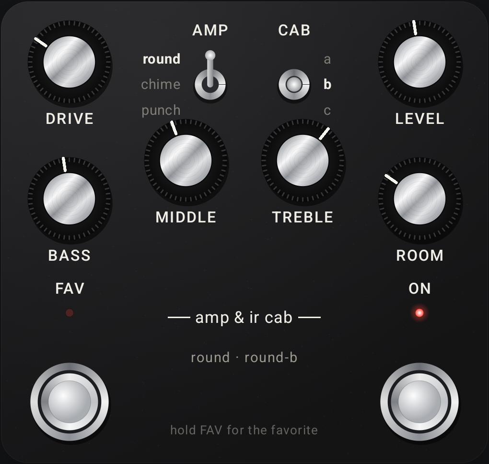

# Iridium Control

A modern Android editor and preset librarian for the Strymon Iridium amp & IR cab pedal,
written in Kotlin with Jetpack Compose. Works on current phones (Android 8.0 – 15+).

> Independent hobby project, not affiliated with Strymon.

## Download

**[Download the latest APK](https://github.com/jonsolberg/strymoniridiumcontrol/releases/latest/download/IridiumControl.apk)** · [all releases](https://github.com/jonsolberg/strymoniridiumcontrol/releases)

Current version: **1.1.5** – also on [jonsolberg.se:8080](http://jonsolberg.se:8080). Builds are signed with
the project's release key, so new versions install over old ones and keep your presets.
Needs Android 8.0 or newer.

Screenshots: [pedal screen](docs/screenshot-pedal.png) · [preset library](docs/screenshot-presets.png) ·
demo video: [docs/demo.mp4](docs/demo.mp4)

## Features

- **Pedal-style editor** – DRIVE, LEVEL, BASS, MIDDLE, TREBLE and ROOM knobs, AMP
  (round/chime/punch) and CAB (a/b/c) three-way switches, FAV and ON footswitches with LEDs.
  Drag a knob up/right to turn it, double-tap to centre it.
- **FAV sound** – hold FAV to store the current sound as the favorite (optionally written to
  the pedal, experimental); tapping FAV shows it, just like on the pedal.
- **Live edit settings** – room size, any of the 9 cabs with any amp, amp bypass,
  volume-pedal pre/post.
- **300-slot preset library** (MIDI banks 0–2) with sync status:
  green = stored in the pedal, amber = only in the app. Copy, rename, clear,
  and save one or many presets into the pedal.
- **Backup** – Settings → Backup exports every preset, the FAV sound and the settings to one
  JSON file and restores it again.
- **Import/export** of selected presets as JSON – also reads files exported by the old
  Iridium Controller app.
- **Follows the pedal**: turning the real knobs, switches and footswitches moves the ones in
  the app. Needs the pedal's MIDI Output set to ON (green): unplug USB, hold both footswitches
  while connecting power, release when the LEDs stop blinking, turn LEVEL until the ON LED is
  green, then press ON.
- **Connections**: USB (pedal's USB port via OTG), any class-compliant USB MIDI
  interface, or Bluetooth LE MIDI adapters. Remembers and auto-connects the last device.
- MIDI monitor and connection test.

## MIDI used

| CC | Function | CC | Function |
|---|---|---|---|
| 0 | Bank (0–2) | 18 | Room size 1–3 |
| 9 | Volume pedal pre/post | 19 | Amp 1–3 |
| 12 | Level | 20 | Cab 0–8 |
| 13 | Drive | 21 | Amp disable |
| 14 | Bass | 27 | FAV footswitch (pedal sends 1 press / 0 release; app sends 127 / 0) |
| 15 | Middle | 28 | ON footswitch (pedal sends 1 press / 0 release; app sends 127 / 0) |
| 16 | Treble | 102 | Bypass (0) / on (127) |
| 17 | Room level | PC | Recall preset |

**Saving into the pedal:** recall the slot (bank + PC), send all CCs, press-and-hold FAV
via CC 27 so the pedal enters save mode, release, then confirm with a Program Change
(firmware 1.33+) or a second FAV press (selectable in Settings, as is the hold time).

## Building

GitHub Actions builds a release APK on every push to `main` (download it from the
run's artifacts) and attaches it to a GitHub release when a `v*` tag is pushed.

Release builds are signed with the key stored in these repository secrets: `SIGNING_KEYSTORE_B64` (base64 of the .jks), `SIGNING_STORE_PASSWORD`,
`SIGNING_KEY_ALIAS`, `SIGNING_KEY_PASSWORD`. Without them (e.g. in a fork) the APK is
debug-signed.

Locally: `./gradlew assembleRelease` (JDK 17, Android SDK 35).

## Website

The app is listed in the Tools section of [jonsolberg.se:8080](http://jonsolberg.se:8080);
`docs/website/iridium-shot.webp` is the screenshot used there.

## License

Copyright © 2026 Jon Solberg

This program is free software: you can redistribute it and/or modify it under the terms of the
GNU General Public License as published by the Free Software Foundation, either version 3 of the
License, or (at your option) any later version.

This program is distributed in the hope that it will be useful, but WITHOUT ANY WARRANTY; without
even the implied warranty of MERCHANTABILITY or FITNESS FOR A PARTICULAR PURPOSE. See the
[GNU General Public License](LICENSE) for more details.
